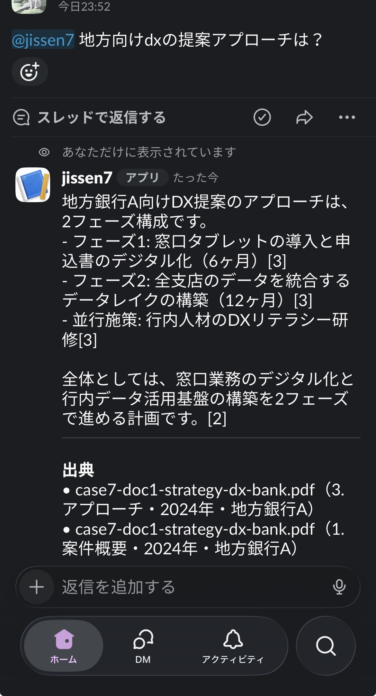
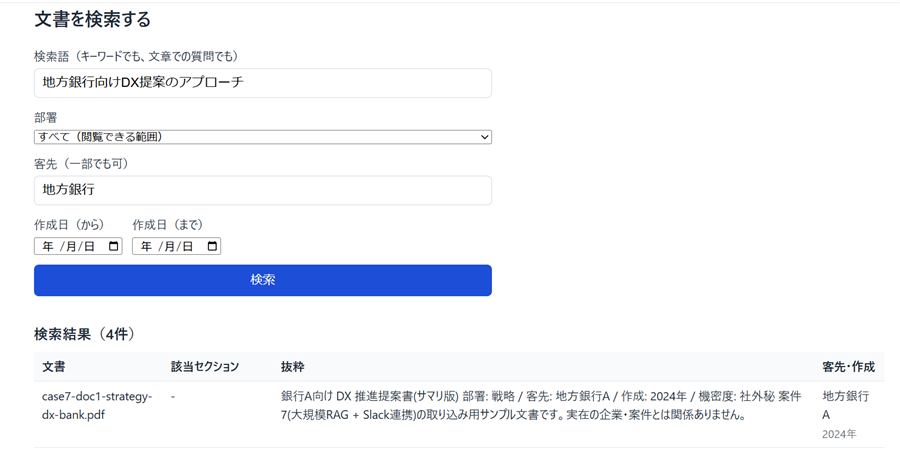

# RAG ナレッジ検索 + Slack ボット

SharePoint 上の PDF / Word（約 5,000 件）を対象に、Slack で質問すると**出典つきの要約**を返すボットです。Web 画面からの詳細検索と、管理者向けの管理画面もあります。要件は `要件定義書.md` を参照してください。

- 本番: https://rag-knowledge-slack.vercel.app （ログインが必要）
- 開発者向けの詳しいメモ（設計の経緯、運用ルール、つまずきやすい点）は `CLAUDE.md` にあります。

## 状態

MVP 完成。Vercel に本番デプロイ済みで、Slack の DM・チャンネル、管理画面、Web 検索を実機で確認しています。

**SharePoint の実接続だけが未確認です**（個人アカウントでは Azure のアプリ登録ができないため。要件定義書 Q-06）。
文書の入手元は 2 通りあり、同期の本体（`runSync`）は共通です。

| 入手元 | 場所 | 確認状況 |
|---|---|---|
| SharePoint（Microsoft Graph） | `src/lib/graph/client.ts` | モックを使ったテストのみ |
| ローカルフォルダ | `src/lib/sources/local.ts` | 本物の DB で確認済み |

| 受入テスト | 内容 | 状況 |
|---|---|---|
| AC-02 | Slack で 30 秒以内に出典つき要約 | 実機で確認（約 4〜5 秒） |
| AC-04 | 6 部署の権限分離 | 自動テストで合格 |
| AC-05 | 該当なしのとき創作しない | 自動テストで合格 |
| AC-06 | 同期で追加・更新・削除が反映される | 自動テストで合格 |
| AC-07 | Web の部署・客先・日付の絞り込みと権限 | 自動テストと目視で確認 |
| AC-08 | 管理者が取り込み結果と質問ログを確認 | 目視で確認 |
| AC-01 | 約 5,000 件の取り込み | **未確認**（SharePoint 接続後） |
| AC-03 | 出典リンクから SharePoint の元文書へ遷移 | **未確認**（SharePoint 接続後） |

## 何ができるか

| 機能 | 概要 |
|---|---|
| 取り込み | 文書を読み取り、段落ごとに分割（チャンク）して数値ベクトル（Embedding）にし、DB に保存する |
| Slack ボット | ボットに DM、またはチャンネルでメンションして質問すると、出典つき要約を返す |
| Web 詳細検索 | `/search`。部署・客先・期間で絞り込む（AI 要約は付けない） |
| 管理画面 | `/admin`。同期結果、失敗した文書、部署未判定の文書、質問ログ（`/admin/logs`）、ユーザーと部署を管理する |

**アクセス制御が中核です。** 検索結果は、質問者の所属部署が閲覧できる文書だけに限られます。部署が判定できない文書は誰にも見せません。

### Slack ボット

チャンネルでボットにメンションして質問すると、根拠の文書だけから作った要約と、DB の値から組み立てた出典（文書名・セクション・作成年・客先）が返ります。チャンネルでの返信は質問者本人にだけ表示されます（「あなただけに表示されています」）。



### Web 詳細検索

ログインした利用者が、検索語に加えて、部署・客先・期間で絞り込めます。結果には該当セクションと抜粋、客先・作成年が出ます。部署の選択肢は、自分が所属する部署だけです。



### 利用上の制限

- 1 人あたり直近 1 時間に 60 回まで（Slack・Web 共通。失敗した質問も数える）
- 質問・検索語は 1,000 文字まで
- Slack のチャンネルでのメンションへの返信は、`chat.postEphemeral` で**質問者本人にだけ**表示される（他部署の人に回答が見えないように）。DM は通常の投稿。そのため、チャンネルでの返信は他の人には見えず、履歴も残らない
- 根拠が見つからない質問には、推測せず「見つかりません」と返す

## 構成

```
SharePoint --(月次 Cron /api/cron/sync)--> 取り込み
  変更取得 -> PDF/docx 解析 -> チャンク分割 -> メタデータ抽出 -> Embedding -> 保存
        |
        v
Supabase (Postgres + pgvector + RLS)
        |
   +----+-----+
   v          v
Slack Bot   Web 詳細検索
```

- Next.js 15 (App Router, TypeScript) / Vercel
- Supabase（Postgres, pgvector, Auth）
- Embedding: OpenAI `text-embedding-3-small`、要約: Claude
- SharePoint: Microsoft Graph（読み取り専用）

主なディレクトリ:

- `src/lib/ingest/` 取り込み部品とパイプライン
- `src/lib/sources/` 入手元の窓口とローカルフォルダ版、`src/lib/graph/` SharePoint 版
- `src/lib/sync/` 同期の実行・記録・再開
- `src/lib/rag/` 検索と回答生成
- `src/lib/slack/`、`src/app/api/slack/events/` Slack 連携
- `src/app/admin/`、`src/app/search/`、`src/app/login/` 画面
- `src/acceptance/` 本物の DB を使う受入テスト
- `supabase/migrations/` DB の変更履歴
- `scripts/` 動作確認用スクリプト

## セットアップ

```bash
npm install
cp .env.example .env.local   # 値を設定する（秘密鍵をチャットや Git に載せない）
```

### 環境変数

| 変数 | 用途 |
|---|---|
| `NEXT_PUBLIC_SUPABASE_URL` / `NEXT_PUBLIC_SUPABASE_ANON_KEY` | Supabase 接続（ブラウザに出る公開用の値） |
| `SUPABASE_SERVICE_ROLE_KEY` | サーバー専用。クライアントに出さない |
| `SLACK_SIGNING_SECRET` | Slack からのリクエストの署名検証 |
| `SLACK_BOT_TOKEN` | **`xoxb-` で始まる** Bot User OAuth Token |
| `ANTHROPIC_API_KEY` / `CLAUDE_MODEL` | 回答生成 |
| `OPENAI_API_KEY` / `EMBEDDING_MODEL` | Embedding |
| `AZURE_TENANT_ID` / `AZURE_CLIENT_ID` / `AZURE_CLIENT_SECRET` / `SHAREPOINT_DRIVE_ID` | SharePoint（Graph）。未接続の間は不要 |
| `CRON_SECRET` | `/api/cron/sync` の認証。Vercel にも同じ値を設定する |
| `SYNC_SOURCE` | `sharepoint`（既定）または `local` |
| `LOCAL_SOURCE_DIR` | `SYNC_SOURCE=local` のときの取り込み元フォルダ |

### Slack アプリの設定

Slack API の管理画面（https://api.slack.com/apps）で設定します。変更したら必ず **Save Changes** を押し、案内が出たら **Reinstall to Workspace** します（忘れると反映されません）。

- **Socket Mode は必ずオフ。** オンだと、イベントが Request URL に届かず、ボットが無反応になります
- **Event Subscriptions**
  - Request URL: `https://<ドメイン>/api/slack/events`（「Verified」と出ること）
  - Bot Events: `message.im`（DM）、`app_mention`（チャンネルでのメンション）
- **OAuth & Permissions の Bot Token Scopes**: `chat:write`, `app_mentions:read`, `im:history`, `users:read`, `users:read.email`
- **App Home**: 「Messages Tab」をオンにし、「Allow users to send Slash commands and messages from the messages tab」にチェック
- チャンネルで使うときは、ボットをチャンネルに招待する（`/invite @ボット名`）
- ユーザーと部署の紐づけは **Slack のメールアドレスと一致**で行う。登録の無い人には検索せず案内を返す

うまく動かないときの切り分け:

- スコープ不足: `https://slack.com/api/auth.test` の応答ヘッダー `x-oauth-scopes` で、付与済みのスコープを確認できる
- メール照合: `users.lookupByEmail` が `ok: true` を返すか
- 到達の確認: Vercel の Hobby プランは実行ログが直近 30 分しか見られないため、管理画面の質問ログ（`/admin/logs`）に記録が増えるかで見る

### Supabase の設定

- `supabase/migrations/` を順に適用する（0001〜0013）
- Authentication で **「Confirm email」を必須**にし、**公開サインアップを無効**にする（確認済みメールを信用して利用者を紐づけているため）。現在の設定は `<Supabase の URL>/auth/v1/settings` の `disable_signup` と `mailer_autoconfirm` で確認できる
- サインアップが無効なので、**Web 検索の利用者は、Supabase のダッシュボードから招待・作成する**
- Slack の利用者は、管理画面の「ユーザー」で、Slack に登録されたメールアドレスと部署を登録する
- 管理者の追加・解除は画面からできない。`users.is_admin` を DB で直接更新する

### デプロイ（Vercel）

GitHub と連携済みで、`main` に push すると本番に自動でデプロイされます。環境変数は、画面または CLI で登録します。

```bash
npx vercel env add <名前> --environment production --type secret --value "<値>" --yes
```

- パイプ（`echo 値 | vercel env add`）で渡すと、値の末尾に改行が混ざり、デプロイが失敗することがあるため、`--value` を使う
- `NEXT_PUBLIC_` で始まる名前は、ブラウザに公開される値なので `--type config` にする
- `vercel.json` の月次 Cron は本番デプロイでのみ動く。Hobby プランでは、Cron の頻度や関数の最大実行時間に制限がある

## 開発コマンド

```bash
npm run dev         # 開発サーバー
npm run build       # ビルド
npm run typecheck   # 型チェック
npm test            # 全テスト（Vitest）。本物の DB が要る受入テストはスキップされる
npx vitest run path/to/file.test.ts   # 単一ファイル
```

サンプル PDF を使うテストは `テスト用PDF_元ファイル/` が無いと自動でスキップされます。

### 受入テスト（本物の DB を使う）

`src/acceptance/` のテストは、本物の Supabase（と OpenAI）に対して、仮のユーザーや文書を作って検証し、終了時に必ず消します。既存のデータは変更しません。

```bash
RUN_ACCEPTANCE=1 npx vitest run src/acceptance
```

- 同じ DB を共有するため、テストファイルは**直列で実行**する（`vitest.config.ts` で設定済み。並列だと、他のテストの一時データが混ざって権限の判定が崩れて見える）
- OpenAI の Embedding を数回呼ぶ（費用は数円未満）

### 動作確認用スクリプト

```bash
npx tsx --conditions=react-server --env-file=.env.local scripts/<名前>.ts
```

- `sync-local.ts` ローカルフォルダを本物の DB に取り込む
- `try-search.ts` 生の類似度を表示する
- `try-ask.ts` 検索から回答までを通しで確認する

## 同期（取り込み）

- 入口は `GET /api/cron/sync`（`Authorization: Bearer <CRON_SECRET>` が必須）。`vercel.json` で月次実行
- 実行時間の制限があるため、時間切れで途中停止し、次回に続きから再開する
- **初回の全件取り込みは 1 回で終わりません。** 応答の `stoppedEarly` が `false` になるまで繰り返し呼ぶ
- 失敗は `ingestion_errors` に記録され、管理画面で確認できる。やり直しても直らない失敗は飛ばし、一時的な失敗は次回やり直す
- 二重起動は DB 側で防ぐ

### 取り込みの規則を変えたとき

部署・客先・日付の抽出、見出し判定、チャンク分割の規則を変えたら、`src/lib/config.ts` の `pipelineVersion` を +1 します。版数が違う文書は、内容が同じでも次回の同期で再処理されます。

## 文書の書式

1 行目がタイトル、2 行目に `部署: 戦略 / 客先: 地方銀行A / 作成: 2024年 / 機密度: 社外秘`、本文は `1. 見出し` 形式。部署・客先・日付は**文書冒頭の記載から正規表現で抽出**します（権限に直結するため AI の推測は使いません）。

部署の判定は**全か無か**です。次の場合は権限を付けず、誰にも見せない状態で保存し、管理画面で確認できるようにします。

- 部署の記載が無い、または登録名と一致しない
- 併記の一部だけが登録名に一致する
- 表紙に部署欄が複数あり、内容が食い違う

## 外部送信について

Embedding（OpenAI）と回答生成（Claude）に、文書の本文が送信されます。サンプルは架空文書ですが、実運用の前に要件定義書 Q-07 で扱いを確認してください。

## 既知の制限・注意

- **SharePoint の実接続と 5,000 件の投入は未実施**です。接続できたら、環境変数（`AZURE_*`、`SHAREPOINT_DRIVE_ID`）を登録し、`/api/cron/sync` を繰り返し呼びます。全件投入のあとで、類似度の下限（`config.search.minSimilarity`）を `scripts/try-search.ts` で見直してください
- **管理者（`is_admin`）の行のメールアドレスは変更しないでください。** 変更すると、新しいメールの人が管理者になります（Slack・ログインの紐づけは外れますが、`is_admin` は行に残るため）
- 大量投入では、時間切れ後の再開で済んだファイルを再ダウンロードする無駄があります（`lastModified` による事前スキップは未実装）
- スコープ外: 予算、Phase 2、PowerPoint / OCR、役職階層別の権限、提案書ドラフト生成
